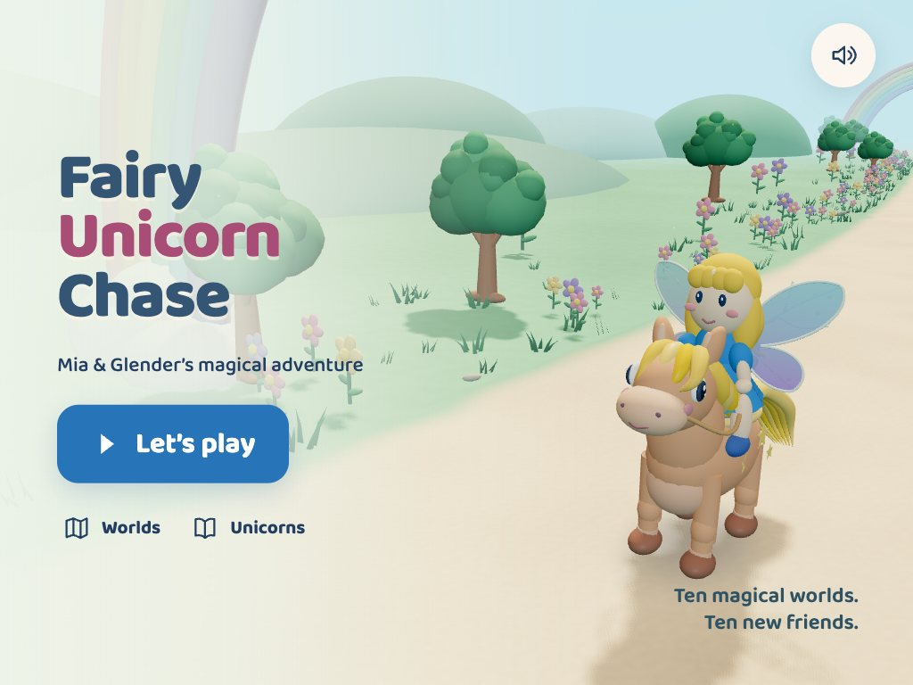
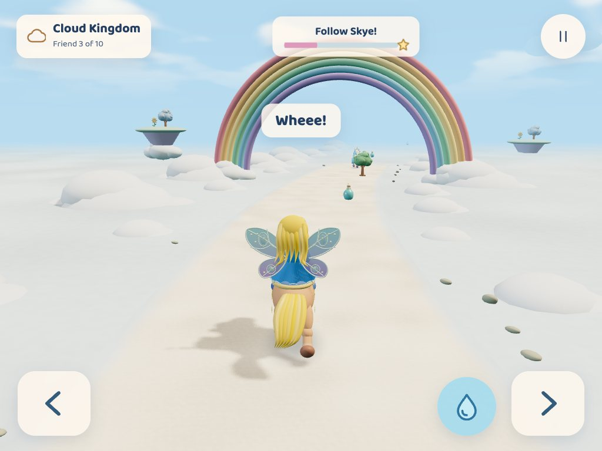
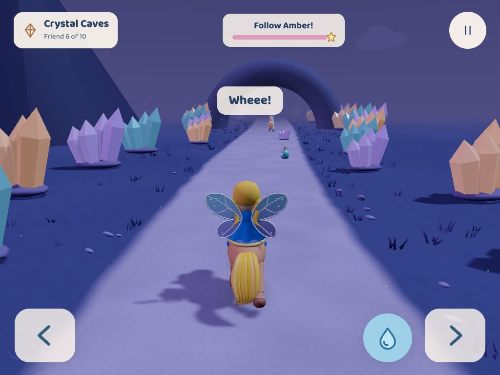
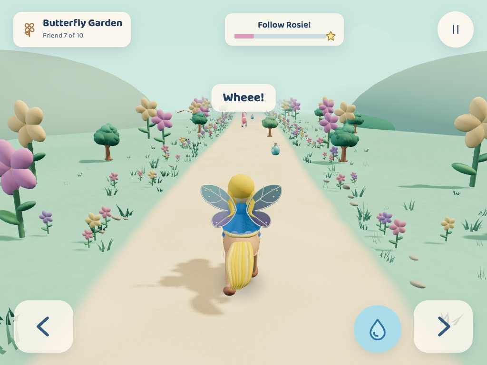
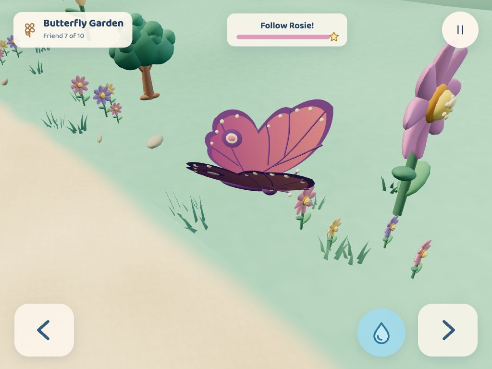
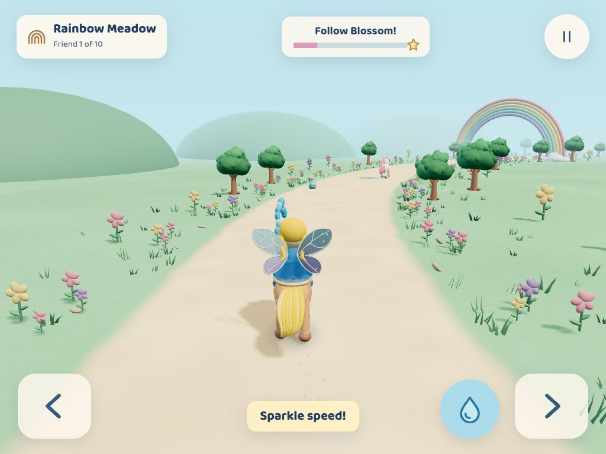
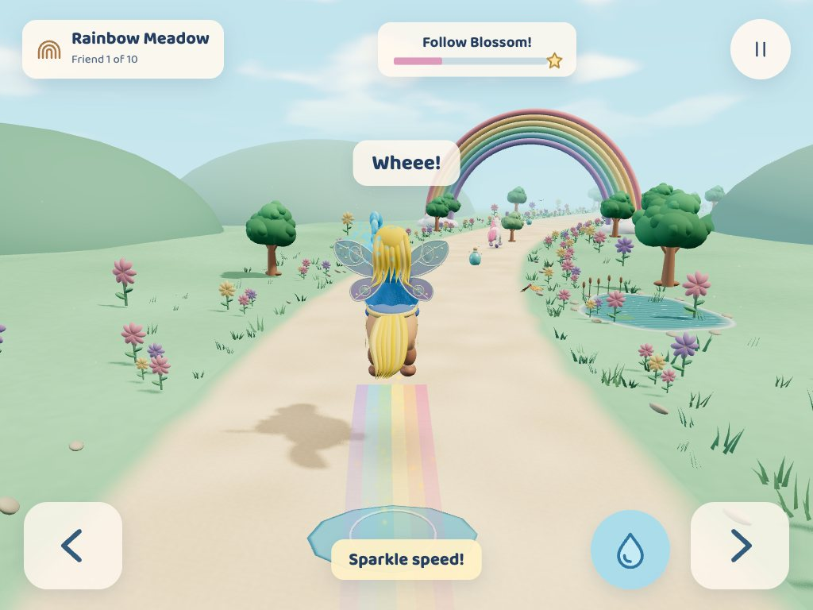
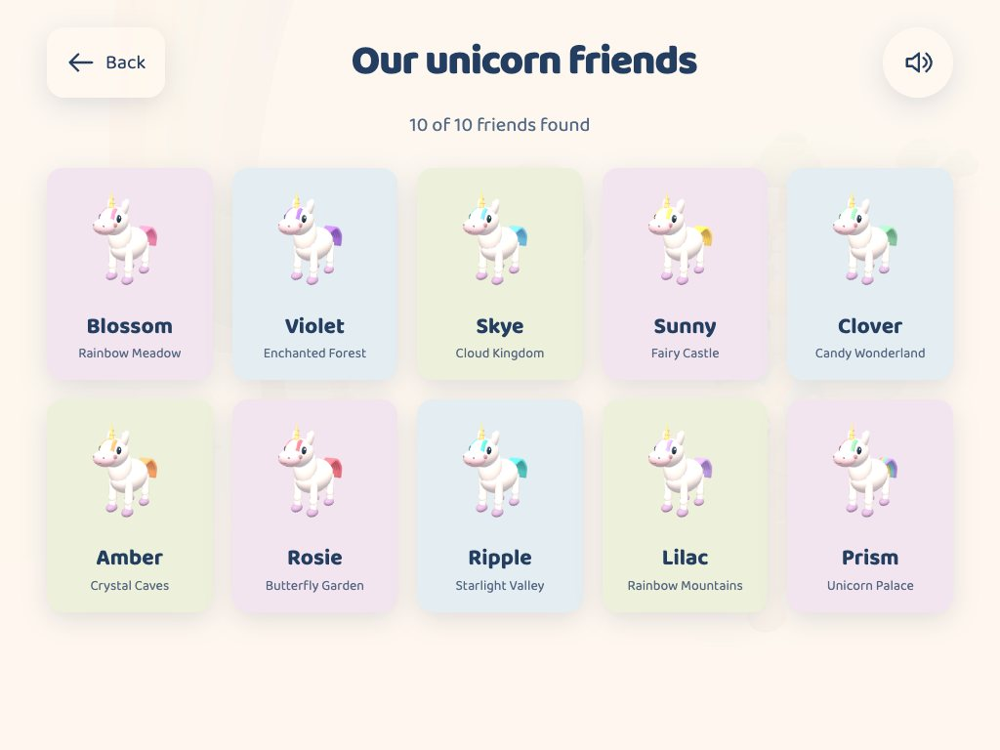
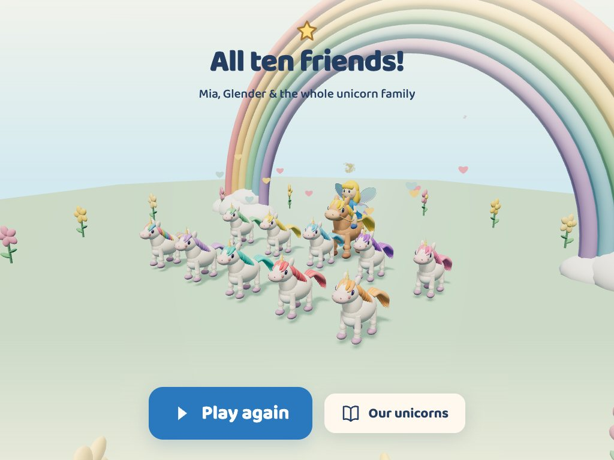

# Fairy Unicorn Chase

**A little fairy. A starry pony. Fifteen magical new friends.**

[](https://fuc.christopherbrown.ai)

### [Play Fairy Unicorn Chase →](https://fuc.christopherbrown.ai)

A gentle 3D adventure for small hands: ride with Mia and Glender, follow a white unicorn through a magical world, collect sparkly potions, and catch a new friend. Find all fifteen and bring the whole unicorn family together.

The idea, characters, and rules came from a six-year-old creative director, with her dad helping turn her imagination into a game. Her decisions are the heart of the project; her personal identity stays private.

## Small hands, big adventure

- **Just steer.** Glender runs automatically. Hold a big arrow, release to settle back into the middle, and enjoy the winding path.
- **A friendly chase.** Potions help you really close the distance. Gentle assistance keeps every unicorn catchable; there are no lives, countdowns, or fail screens.
- **A living storybook.** Grass sways beside lily ponds, clouds drift overhead, and a rainbow ribbon follows Glender during a potion boost.
- **A splash of magic.** Mia raises her arm and sprays a sparkling blue water stream. It is harmless, joyful, and completely optional.
- **Wheee!** Glender automatically jumps over puddles and logs. Trees give a little bump and a brief slowdown.
- **A growing collection.** Catch a unicorn, celebrate together, unlock the next world, and reveal a new friend in the collection book.
- **A grand finale.** Mia, Glender, and all fifteen unicorns gather on a flower-ringed island under a rainbow.

Progress and sound/picture/motion preferences save in this browser. No account, purchases, advertisements, analytics, or backend are involved.

## Meet Mia & Glender

Mia has flowing blonde locks, a blue dress, gently fluttering fairy wings, and water powers. She rides **Glender**, an apricot pony with a golden-yellow mane and tail, star markings, a cheerful gallop, and a knack for hopping over puddles.

The unicorns have white coats, gold horns, friendly faces, and fifteen different mane and tail colors. They are playing chase with Mia, and are happy to be found.

## A peek into the adventure

These are real screenshots of the running game, captured at an iPad-sized landscape viewport.

| Above the clouds | Into the crystals |
| --- | --- |
|  |  |
| **Butterfly Garden** | **A butterfly, up close** |
|  |  |
| **Mia’s water magic** | **Glender’s automatic jump** |
|  |  |
| **Our unicorn friends** | **The original ten together** |
|  |  |

[See the catch celebration](docs/screenshots/catch.jpg) · [Choose a world](docs/screenshots/worlds.jpg) · [View every screenshot](docs/screenshots)

## Fifteen worlds, fifteen friends

| World | A little magic | Unicorn / mane |
| --- | --- | --- |
| 1 · Rainbow Meadow | Petaled flowers, rippling lily ponds and rainbow arches | Blossom · pink |
| 2 · Enchanted Forest | Tall trees and giant mushrooms | Violet · purple |
| 3 · Cloud Kingdom | Puffy cloud banks and floating rainbow paths | Skye · sky blue |
| 4 · Fairy Castle | Turrets, flags and pastel garden trees | Sunny · yellow |
| 5 · Candy Wonderland | Lollipop trees and candy-colored mushrooms | Clover · mint green |
| 6 · Crystal Caves | Luminous crystals and broad cave arches | Amber · orange |
| 7 · Butterfly Garden | Giant flowers and fluttering butterflies | Rosie · red |
| 8 · Starlight Valley | A starry sky, soft aurora and lavender trees | Ripple · turquoise |
| 9 · Rainbow Mountains | Snow-tipped peaks and rainbow arches | Lilac · lavender |
| 10 · Unicorn Palace | Golden domes, flowers and rainbow scenery | Prism · rainbow |
| 11 · Spooky House | Moonlit houses, glowing pumpkin smiles and friendly floating ghosts | Boo · pale green |
| 12 · Minecraft Meadow | Grass blocks, cube oaks, diamond ore, pigs and friendly creepers | Pixel · emerald green |
| 13 · Pokémon Park | Pikachu, Bulbasaur, Squirtle, Poké Ball gates and Pokémon Centers | Spark · cobalt blue |
| 14 · Candy Carnival | Peppermint pinwheels, friendly gummy bears, cupcake stalls, donut gateways and cake pavilions | Taffy · coral |
| 15 · Coral Lagoon | A pale sandy path, branching coral, kelp, lavender tube sponges, golden sea stars, pearl shells and friendly reef fish | Pearl · sea blue |

Each world has its own complete loop, pickups, obstacles, palette, unicorn, and celebration. The meadow introduces the adventure quickly. Deterministic no-steering play takes about 23 seconds there and 61–70 seconds in later worlds; finding more potions can shorten a chase.

World names, unicorn nicknames, Glender’s base coat, and tuning are **provisional**. The creative director can change them. Her confirmed decisions and the open choices are recorded in [DESIGN_NOTES.md](DESIGN_NOTES.md).

## How to play

Turn an iPad sideways, tap **Let’s play**, and follow the unicorn. There is no accelerate or jump button.

| Action | iPad / touch | Desktop |
| --- | --- | --- |
| Steer left / right | Hold the large arrow buttons | Left/Right arrows or A/D |
| Settle back to center | Release the arrow | Release the key |
| Spray water | Tap or hold the blue droplet; steering can continue | Space |
| Pause / resume | Tap Pause, then Keep chasing | Escape, or use the buttons |

Pause also offers Restart, Home, sound, picture quality, and Gentle motion. **Automatic** picture quality caps resolution and can lower it and turn off detailed shadows if rendering stays slow; choose **Gentle** on a less powerful device. The game remains playable muted, and sound starts only after a browser-permitted user gesture.

Choose **New game** on the home or pause menu to start over. The confirmation warns that collected unicorns and world unlocks will reset. **Cancel** or Escape keeps your adventure; **Start new game** clears the saved collection and begins Rainbow Meadow. Sound, picture quality and gentle motion settings stay the same.

## Run locally

Use Node.js 22.12 or newer. GitHub Actions uses Node 22; local build and tests were verified with Node 25.5 on macOS.

```bash
git clone https://github.com/christopherrbrown3/fairy-unicorn-chase.git
cd fairy-unicorn-chase
npm ci
npm run dev
```

Open the local address Vite prints, normally `http://127.0.0.1:5173/`.

```bash
npm run build
npm run preview

npm test
npx playwright install chromium webkit
npm run test:browser
```

`npm run test:all` runs unit tests, a production build, and both browser projects. Linux may need `npx playwright install --with-deps chromium webkit`. `node tools/serve.mjs` serves the production build strictly at both `/` and `/fairy-unicorn-chase/` on port 4173 for the hosting checks. Browser tests use it automatically.

For a fresh screenshot gallery, start `npm run dev` on port 5173, then run `node tools/capture.mjs`. It uses an isolated browser and the opt-in test interface to advance real chases quickly.

## Publishing & custom domain

The public repository is [christopherrbrown3/fairy-unicorn-chase](https://github.com/christopherrbrown3/fairy-unicorn-chase). Changes go through pull requests, which run the build, unit tests and Chromium gameplay checks. Merges to `main` and manual dispatch run [the Pages workflow](.github/workflows/deploy.yml), repeating validation before artifact upload and deployment through GitHub’s official Pages actions.

**Production is live at [fuc.christopherbrown.ai](https://fuc.christopherbrown.ai).** Repository Pages settings use GitHub Actions, configure this custom domain, report domain verification and an approved certificate, and enforce HTTPS. HTTP redirects to HTTPS. The [GitHub Pages fallback](https://christopherrbrown3.github.io/fairy-unicorn-chase/) redirects to the custom domain.

Namecheap’s authoritative DNS is hosted at `dns1.registrar-servers.com` and `dns2.registrar-servers.com`. The existing explicit record was verified:

| Type | Host | Target | TTL |
| --- | --- | --- | --- |
| CNAME | `fuc` | `christopherrbrown3.github.io` | Existing 1800 seconds |

**No Namecheap action is currently required.** If the record ever needs repair, use Namecheap → Domain List → Manage `christopherbrown.ai` → Advanced DNS → Host Records, and update only the explicit `fuc` record. The target is a hostname without `https://` or a repository path. The existing wildcard and other subdomains were preserved; no DNS writes were made during this implementation.

The custom domain is configured in repository Pages settings, rather than inferred from a CNAME file. Vite uses `base: './'`; asset paths, the font, and GLB work under the root and repository subpath, with no backend rewrite or history routing.

## Make the adventure her own

The static JavaScript modules use **Three.js + WebGL**, **Vite**, **Web Audio**, and versioned **localStorage** saves.

| Change | Start here |
| --- | --- |
| World names, unicorn names, mane colors, palettes, widths and chase tuning | [src/config/levels.js](src/config/levels.js) |
| Mia’s colors and Glender’s coat / mane | `CHARACTER` in the same config, then [src/characters/characters.js](src/characters/characters.js) |
| World scenery and landmarks | [src/worlds/world.js](src/worlds/world.js), [props.js](src/worlds/props.js) |
| Water duration / cooldown and visual stream | `MAGIC` in config, [src/game/scene.js](src/game/scene.js) |
| Pursuit, potion pickup, automatic jumping and gentle bumps | [src/game/chase.js](src/game/chase.js) |
| Original sounds and gentle music | [src/audio/audio.js](src/audio/audio.js) |
| Menus, icons and touch controls | [src/ui](src/ui), [game.css](src/styles/game.css) |
| Save schema and graceful recovery | [src/game/save.js](src/game/save.js) |

Characters and environments use custom procedural models with reusable geometry and animation pivots. Mia and the ponies blink; articulated knees bend through gallops and jumps. Flowing hair, embroidered dress details, butterfly wings and spiral unicorn horns reward a closer look. The sparkly potion is an optimized, original Blender GLB, with a procedural fallback. Its [authoring script](tools/blender_potion.py) creates a separate scene and exports only that scene.

Scenery combines soft shadows, textured paths, petaled flowers, layered hills, floating islands and moonlit lighting. Instanced grass bends in the wind; lily ponds ripple; drifting clouds and a starlight aurora use a single sky pass. The boost ribbon follows the actual path and fades, as do individual magic sparkles. Gentle motion holds the new environmental animation still and omits the ribbon. Geometry, particles, shadow maps and render resolution are bounded; level resources are disposed on replacement.

## Tested, with room for a real playtest

**Passing:** deterministic tests and browser cases across Chromium and WebKit; all fifteen distance-based catches; real potion speed, jumps, water and gentle collisions; keyboard and touch input; projected on-screen steering direction; pause and preferences; persistence and corrupt-save recovery; root/subpath assets; the GitHub Actions deployment; live HTTPS and redirects. The original screenshot gallery covers the first ten worlds and the main game states; new-world captures appear in the release history.

**Still to check on a physical iPad:** sustained frame rate, Safari chrome/safe areas, comfortable sound, multitouch feel, and the creative director’s enjoyment. No physical-device testing is claimed. [The device checklist and full coverage notes](docs/QUALITY.md) make that last family playtest straightforward.

Saves belong to this browser and origin; clearing site data removes them, and there is no cross-device sync. The initial load needs a network connection. Landscape is the intended play view; portrait offers a rotation hint and usable menus. Procedural character animation and the provisional artistic choices can continue to grow with her ideas.

## Credits

Mia, Glender, the unicorns, custom geometry, UI icons, screenshots, music, and sound effects were made for this game. Minecraft Meadow and Pokémon Park are unofficial fan-themed levels with custom procedural scenery. **Baloo 2** is self-hosted under the SIL Open Font License; Three.js and Vite use MIT, and Playwright uses Apache 2.0. See [credits, asset provenance, and licensing](docs/CREDITS.md) for details. No downloaded Nintendo or Minecraft models, textures, or game sounds are used.

The next creative choices belong to the little director: name her unicorn friends, choose Glender’s coat, and decide whether Mia’s water should make flowers bloom someday.

[Implementation checklist](IMPLEMENTATION_PLAN.md) · [Creative decisions](DESIGN_NOTES.md) · [Visual system](DESIGN.md)

## New-world releases

Each new world ships in its own pull request and tagged release, with deployment and live gameplay verified before work begins on the next. See [release history](docs/RELEASES.md).
