# Release history

## v1.11.0 — Sculpted character cast

Mia, Glender and all eighteen unicorn variants use original skinned Blender
models with connected anatomy, painted faces and coats, layered eyes, swept hair,
detailed clothing and tack, and translucent veined wings. Independent skeletons
and blink shapes animate the gallop, jumps, rider suspension and water gesture.
The three compressed character models total 1.8 MB and join the complete offline
cache. Existing progress and preferences carry forward.

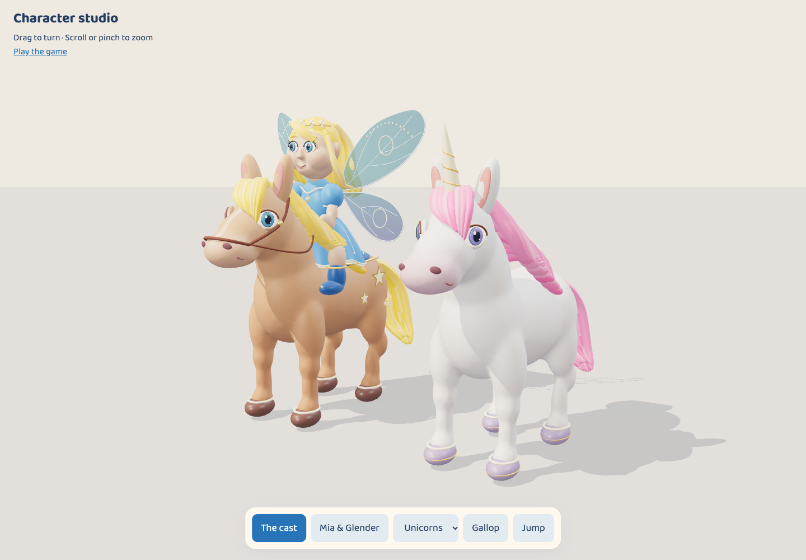

[Actual chase view](screenshots/character-chase.png) ·
[Mia and Glender close-up](screenshots/character-mia.png) ·
[Editable source and rebuilding](CHARACTER_ART.md).

Local verification passed 22 unit tests and 31 browser cases across
Chromium/Metal and WebKit; three duplicate WebKit screenshot cases were skipped.
Physical iPad playtesting remains outstanding.

## v1.10.0 — Big City Downtown

World 18 adds Metro, a white unicorn with a periwinkle mane, to a broad city boulevard with pale sidewalks, shopfront awnings, parked taxis, planters, benches, streetlights and clock towers. Existing saves with all seventeen prior friends unlock Big City Downtown while preserving collection progress and preferences.

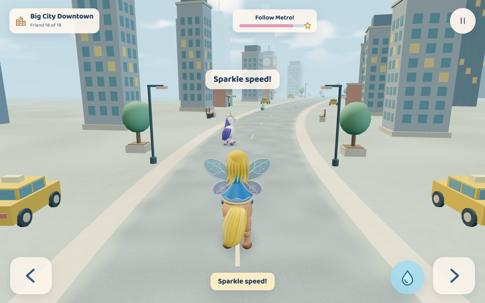

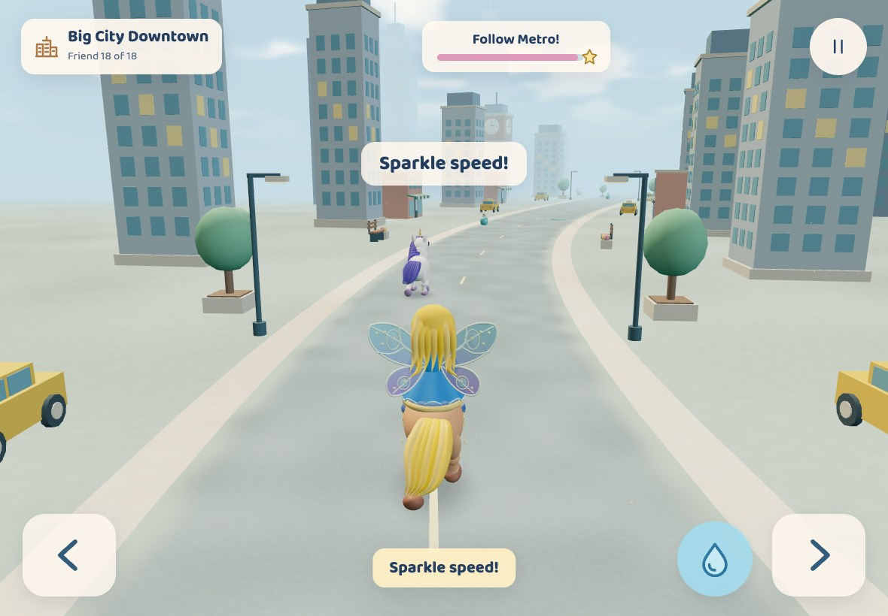

The opening course also shows the blue potion pickup: [normal city chase](screenshots/downtown-potion-visible-ahead.jpg).

The eighteen-friend finale, captured at both sizes: [desktop](screenshots/downtown-finale-desktop.jpg) · [iPad landscape](screenshots/downtown-finale-ipad-landscape.jpg). [Rainbow Meadow preservation capture](screenshots/downtown-meadow-preservation.jpg) checks that the original renderer still presents its familiar world.

## v1.9.0 — Pancake Picnic

World 17 adds Maple, a white unicorn with a maple-brown mane, to a sunny breakfast picnic. A blue runner winds past pancake stacks with butter and syrup, golden waffles, strawberries, sunny-side-up eggs, orange halves, toast cottages, and giant fork-and-spoon gates. Existing saves with all sixteen prior friends unlock Pancake Picnic while preserving progress and preferences. The Home Screen version downloads the complete new world before offering its safe menu update; cached releases continue to launch offline.

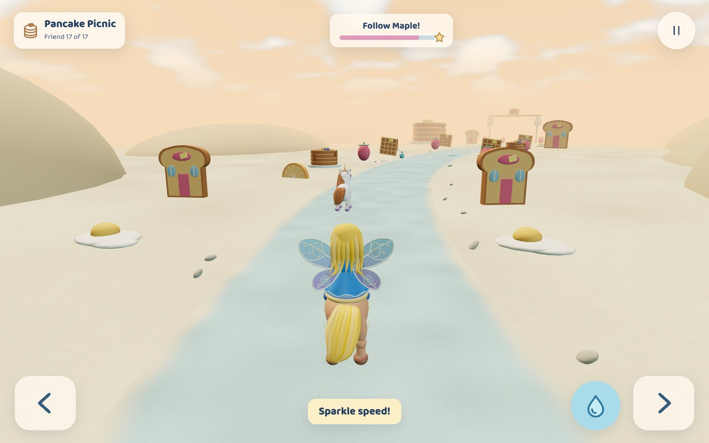

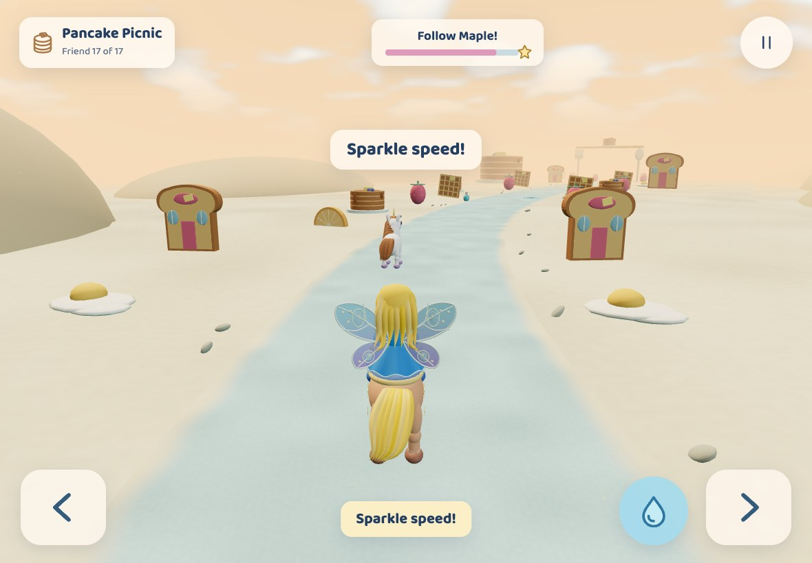

The seventeen-friend finale, captured at both sizes: [desktop](screenshots/breakfast-finale-desktop-v2.jpg) · [iPad landscape](screenshots/breakfast-finale-ipad-landscape-v2.jpg). [Rainbow Meadow preservation capture](screenshots/breakfast-meadow-preservation-v2.jpg) checks the established daylight course after Pancake Picnic.

## v1.8.0 — Home Screen & sharing

Install Fairy Unicorn Chase on a mobile Home Screen with a custom unicorn icon, standalone launch and offline play after the initial download. The title screen offers installation help and a native installer where available. Shared links include an illustrated image, game title and description.

Installed games check for updates at launch, on returning to the foreground and on reconnecting. New releases download completely before an **Update game** action appears in menus, preserving saved unicorns and preferences. Updates wait through active chases, including in another open tab; a failed download retains the previous working version. No reinstall is needed to receive new worlds.

## v1.7.0 — Christmas Village

World 16 adds Holly, a white unicorn with a cranberry mane, to a snowy village with decorated firs, presents, candy canes, snow friends, cozy cottages and garland gates. Gentle-motion snowfall is bounded and pauses with the scene clock. Existing saves with all fifteen friends unlock Christmas Village while preserving collection progress and preferences.

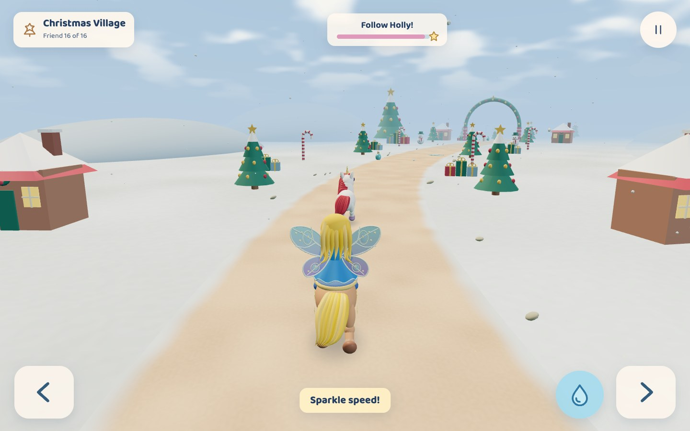

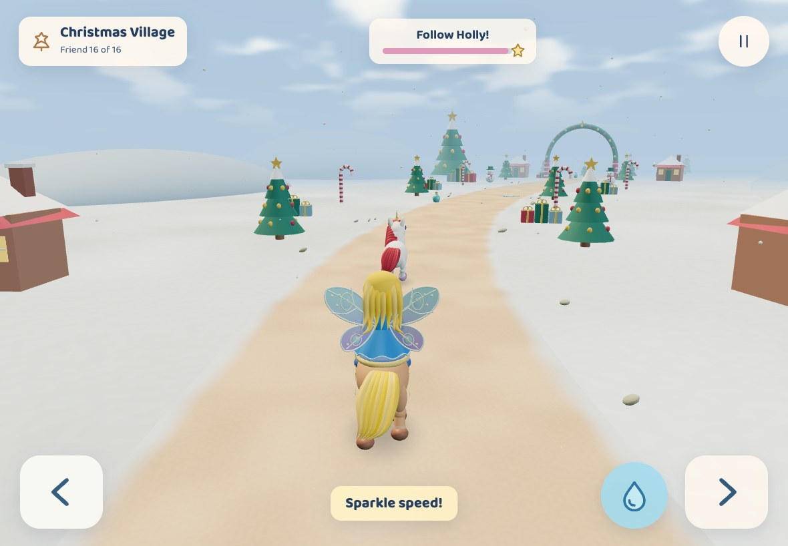

The sixteen-friend finale, captured at both sizes: [desktop](screenshots/christmas-finale-desktop.jpg) · [iPad landscape](screenshots/christmas-finale-ipad-landscape.jpg). [Rainbow Meadow preservation capture](screenshots/christmas-meadow-preservation.jpg) checks the established daylight course after the Christmas world.

## v1.6.0 — Coral Lagoon

World 15 adds Pearl, a white unicorn with a sea-blue mane, to an underwater reef of branching coral, kelp, lavender tube sponges, golden sea stars, pearl shells and friendly striped fish. Rising bubbles and the luminous rippled canopy follow Gentle motion. Existing saves with all fourteen friends unlock Coral Lagoon without losing progress or preferences.

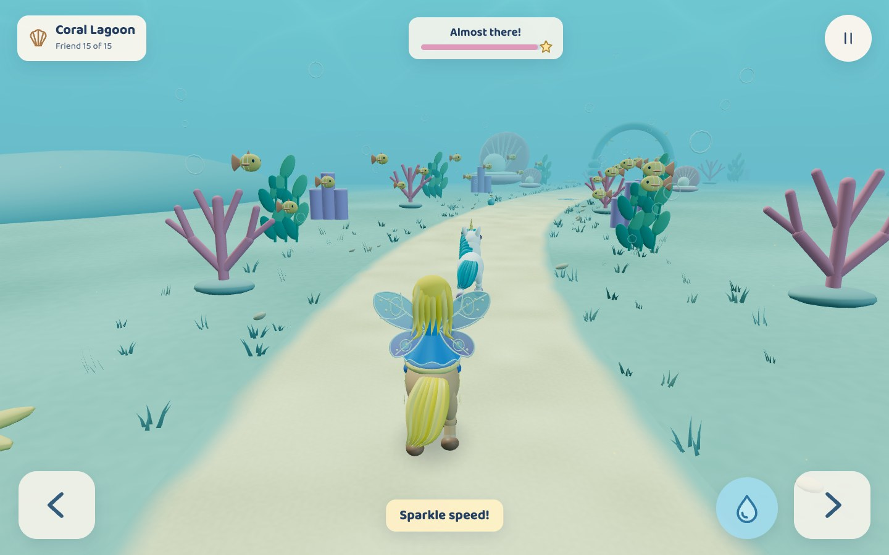

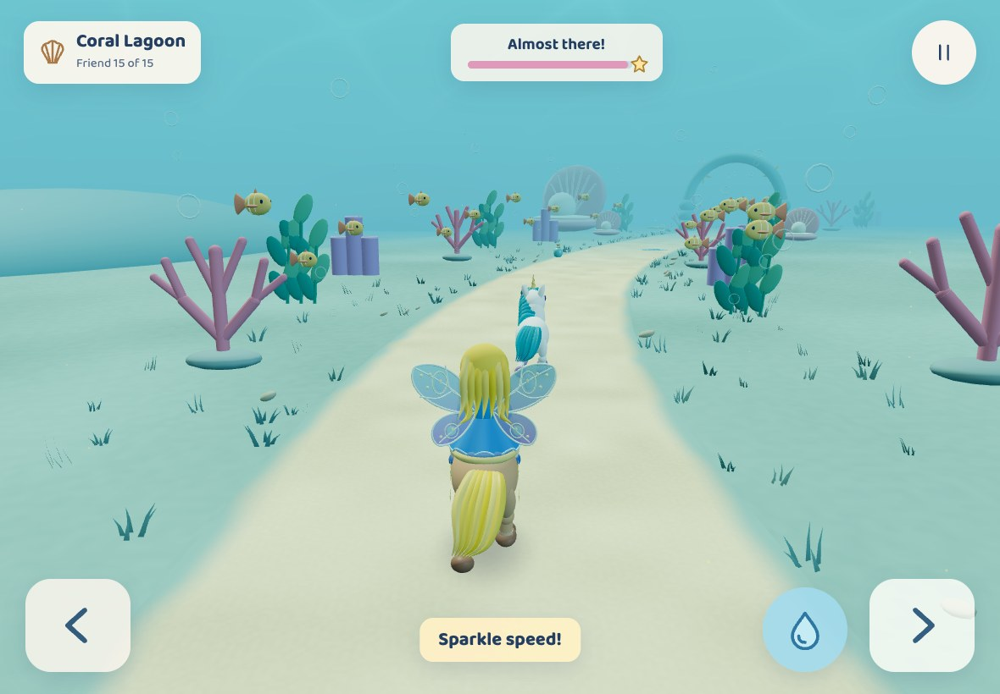

The fifteen-friend finale, captured at both sizes: [desktop](screenshots/coral-finale-desktop.jpg) · [iPad landscape](screenshots/coral-finale-ipad-landscape.jpg). [Rainbow Meadow after changing from the underwater world](screenshots/coral-meadow-preservation.jpg) confirms its daylight colors and familiar scenery return.

## v1.5.0 — Candy Carnival

World 14 adds Taffy, a white unicorn with a coral mane, to a confectionery fairground of peppermint pinwheels, friendly gummy bears, cupcake stalls, sprinkle donut gateways, and tiered cake pavilions. The new course and collection entry unlock for existing saves with all thirteen prior friends preserved.

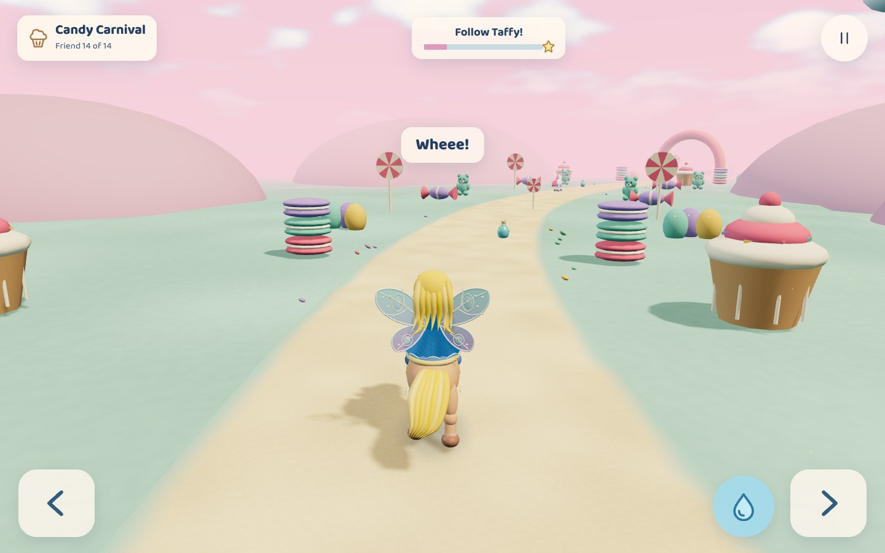

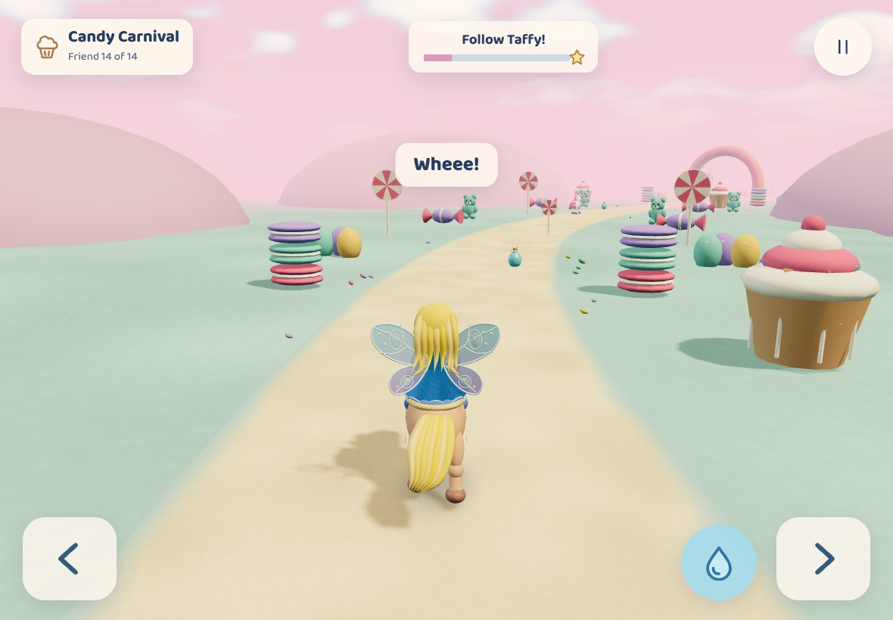

The fourteen-friend finale, captured at both sizes: [desktop](screenshots/candy-finale-desktop.jpg) · [iPad landscape](screenshots/candy-finale-ipad-settled.jpg).

## v1.4.0 — New game

Start over from the home or pause menu with **New game**. A confirmation explains that collected unicorns and world unlocks will reset; **Cancel** or Escape keeps the adventure unchanged. Confirming begins a fresh chase in Rainbow Meadow, while sound, picture quality and gentle motion settings stay the same. All fourteen worlds remain available to discover again.

## v1.3.0 — Pokémon Park

World 13 adds Spark, a cobalt-maned white unicorn, alongside friendly Pikachu, Bulbasaur, Squirtle, Poké Ball garden gates, and Pokémon Centers. Existing saves carry forward into the thirteen-friend collection and finale.

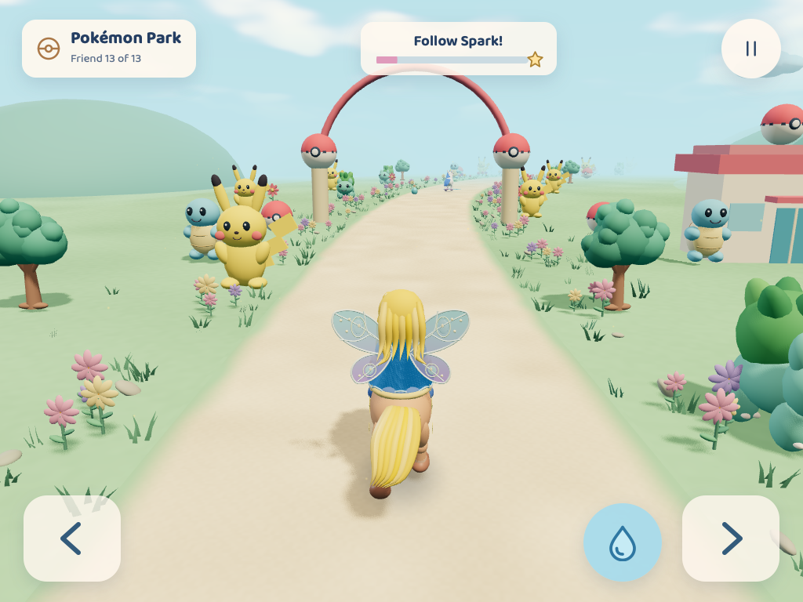

## v1.2.0 — Minecraft Meadow

World 12 adds Pixel, an emerald-maned white unicorn, grass-and-dirt blocks, cube oaks, diamond ore, torches, block pigs, friendly creepers, and broad mine gateways. The familiar gentle chase and saved progress continue.

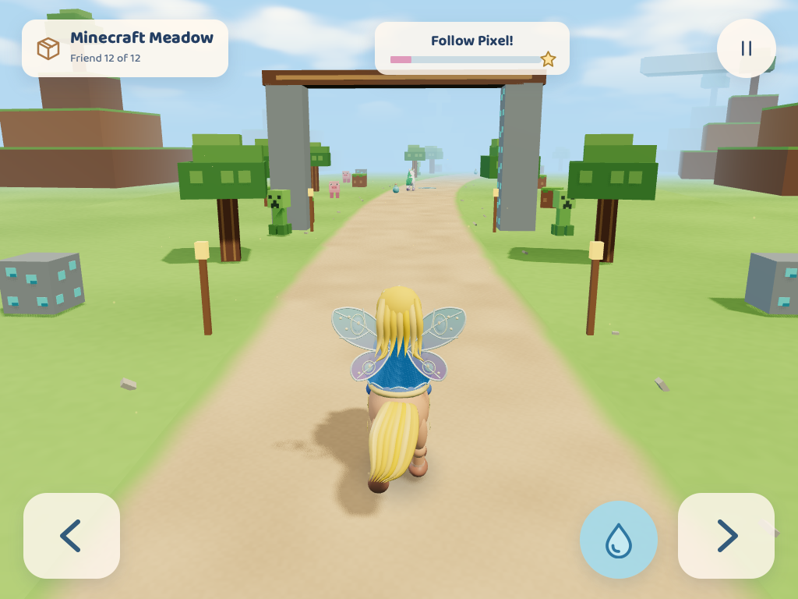

## v1.1.0 — Spooky House

World 11 adds Boo, a white unicorn with a pale-green mane, among moonlit houses, friendly floating ghosts, smiling pumpkins, and illuminated ride-through hallways.

Existing progress is retained. Saves, portraits, collection totals, Continue, and the family finale now follow the released world count. No new controls or failure states.

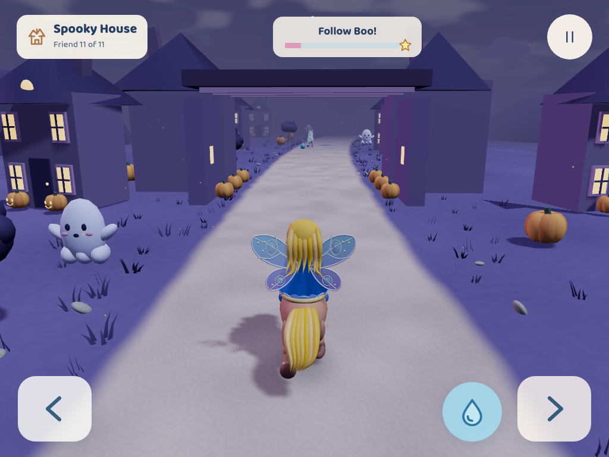
